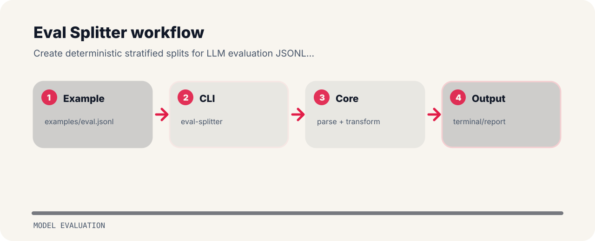

# Eval Splitter

Create deterministic stratified splits for LLM evaluation JSONL datasets.


## File map

```text
.github/        CI workflow
examples/       sample inputs
src/            package source
tests/          test coverage
.gitignore      project file
```

## Shape of the tool



## Try the sample

```bash
git clone https://github.com/mertefekurt/eval-splitter.git
cd eval-splitter
python -m pip install -e ".[dev]"
eval-splitter examples/eval.jsonl
```

## Project notes

- Designed as a focused model evaluation repo.
- Keeps setup short.
- Prioritizes readable output over infrastructure.
