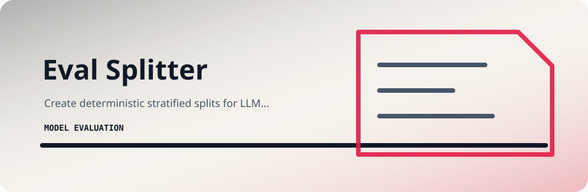

# Eval Splitter



Create deterministic stratified splits for LLM evaluation JSONL datasets.

`Python`

## Start here

```bash
git clone https://github.com/mertefekurt/eval-splitter.git
cd eval-splitter
python -m pip install -e ".[dev]"
eval-splitter examples/eval.jsonl
```

## Project map

```text
.github/        CI workflow
examples/       sample inputs
src/            package source
tests/          test coverage
.gitignore      project file
```

## Repository

[Open the source on GitHub →](https://github.com/mertefekurt/eval-splitter)

[MIT License](LICENSE)
