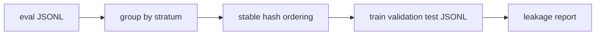

# eval-splitter

`eval-splitter` creates deterministic train, validation, and test splits for LLM evaluation
JSONL files. It keeps categories balanced, writes split files, and reports exact text
leakage across splits.

## Why it is useful

LLM eval datasets are often edited by hand. That makes it easy to create unstable splits or
accidentally place the same prompt in both validation and test. This CLI gives small teams a
repeatable dataset hygiene step without adding a full data platform.

## Key features

- deterministic hash-based splitting
- stratification by any JSON field
- configurable split ratios
- exact normalized text leakage checks
- JSONL outputs for train, validation, and test
- Markdown or JSON summary reports

## Installation

```bash
python -m pip install -e ".[dev]"
```

## Usage

```bash
eval-splitter examples/eval.jsonl --out-dir splits
eval-splitter examples/eval.jsonl --ratios 70,15,15 --strata-field category
eval-splitter eval.jsonl --text-field input --fail-on-leakage
python -m eval_splitter --help
```

Input rows can contain any fields. `category` and `input` are defaults:

```json
{"id":"auth-1","category":"auth","input":"User cannot log in with SSO"}
```

## Workflow



## Tests

```bash
ruff check .
pytest
python -m eval_splitter --help
```

## License

MIT

